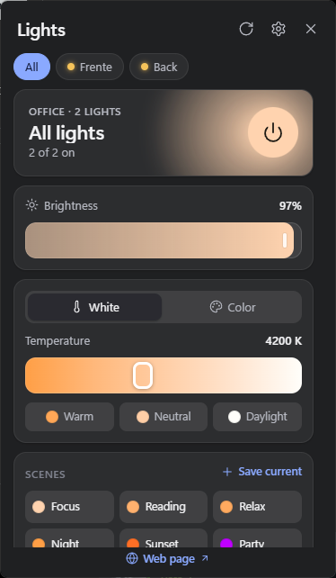
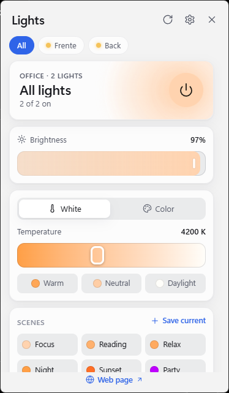

# TapOnLights

A fast, local tray app for TP-Link Tapo smart bulbs on Windows. Click the tray icon, drag a slider, and the light follows, without the phone app and without the cloud.

<p align="center">
  
  &nbsp;&nbsp;
  
</p>

> TapOnLights is an independent project. It is not affiliated with, endorsed by or supported by TP-Link. Tapo is a trademark of TP-Link.

## Features

- **Instant control.** Each bulb keeps one open connection, the UI updates the moment you move a control, and while you drag only the latest value is sent. A change reaches the bulb in about 100–135 ms.
- **Everything the bulbs do day to day:** power, brightness, white temperature (2500–6500 K) with presets, a color wheel with quick swatches, and scenes (six built in, plus your own).
- **Rooms and groups.** Control all lights, a room, or one bulb; the list shows each bulb's state with its own switch.
- **Stays in sync.** Changes made in the Tapo phone app show up within about 10 seconds.
- **Optional web page.** Serve the same controls to a browser, on this PC only or to your phone on the home network, with an optional password.
- **Feels like Windows 11.** Opens next to the tray like Quick Settings, hides when you click away, follows the system light or dark theme, and uses the translucent Mica background.
- **Local and small.** Talks only to your bulbs on the local network: no cloud relay, no telemetry. The installer is about 3.6 MB.

## Compatibility

| | |
|---|---|
| **Tested** | Tapo L530 (hardware 2.0, firmware 1.4.4) |
| **Should work, untested** | Other color bulbs on the same API: L430C, L430P, L535, L630 |
| **Not supported yet** | White-only bulbs (L510, L520, L610), light strips, plugs, other devices |
| **Windows** | Windows 11. Windows 10 should work with an opaque background instead of Mica (untested). |

TapOnLights needs your Tapo account email and password: the bulbs only accept local commands from clients that sign in with the account they're registered to. The sign-in happens directly with each bulb on your network.

It was tested with **Third-Party Compatibility** turned on in the Tapo app (Me › Third-Party Services). The underlying library also supports the newer protocol bulbs use when that setting is off, but that path hasn't been tested yet. If your bulbs refuse to sign in, try switching the setting.

Using another Tapo bulb? Run the [probe](#check-your-bulbs-with-the-probe) and open an issue with its output.

## Install

TapOnLights is built from source for now (see [Building from source](#building-from-source)). The build produces both an installer (per-user, no admin rights) and a standalone `.exe`.

## Getting started

1. **Find each bulb's IP address.** In the Tapo app, open the bulb, tap the gear icon, then Device Info. Your router's list of connected devices shows it too. Give each bulb a fixed address (a "DHCP reservation" on your router) so it doesn't change.
2. **Open Settings** from the popup (gear icon) or the tray menu. Add each bulb's IP address, with an optional name and room, then enter your Tapo account email and password and click **Save**.
3. **Use it.** Left-click the tray icon to open or close the popup; press Esc or click elsewhere to hide it. Right-click the tray icon for *Turn all on*, *Turn all off*, the web page, Settings and Quit.

Turn on **Launch when I sign in to Windows** in Settings to keep it in the tray.

## Web page

Settings › **Web page** serves the same controls to any browser. It's off by default.

- **This PC only (default):** `http://localhost:4530`.
- **Allow other devices on my network:** the page is also served on your local network address (Settings shows it). Windows Firewall asks for permission the first time; allow it on private networks.
- **Password (optional):** the browser asks for it; any username works. It's stored as an Argon2 hash, never in plain text.

Your Tapo account, startup options and the web settings can only be changed in the desktop app, never from the web page. The server only answers requests addressed to an IP address or `localhost`, which blocks DNS-rebinding attacks from other websites.

The page is plain HTTP, so on your network the password travels unencrypted. Use network access only on networks you trust.

### API

The web page uses a small JSON API, which you can also use from scripts, home automation or a Stream Deck. Add `-u :yourpassword` to the commands below if you set a password.

| Method | Path | Body / result |
|---|---|---|
| `GET` | `/api/snapshot` | Bulbs, scenes and status |
| `GET` | `/api/events` | Server-sent events; a `snapshot` event on every change |
| `POST` | `/api/command` | `{"targets": ["<ip>", …], "patch": {…}}`; empty `targets` means all bulbs |
| `POST` | `/api/scenes/apply` | `{"name": "Relax", "targets": []}` |
| `POST` | `/api/refresh` | Re-read every bulb now |

A patch holds any of `on` (true/false), `brightness` (1–100), `temperature` (2500–6500) or `color` (`{"hue": 0–360, "saturation": 1–100}`):

```sh
curl -X POST http://localhost:4530/api/command -H "Content-Type: application/json" \
     -d '{"targets": [], "patch": {"brightness": 40, "temperature": 2700}}'
```

## How it works

```
 Tray popup (WebView2)          Browser (optional)
   Svelte + TypeScript            same UI, served by the app
          │ Tauri IPC                │ HTTP + server-sent events
          ▼                          ▼
 ┌──────────────────── Rust core ─────────────────────┐
 │ bulb manager: one worker and one open session per  │
 │ bulb · instant UI updates · latest-value merging   │
 │ · polling every 10 s                               │
 │ axum web server (off by default)                   │
 └───────────────┬────────────────────────────────────┘
                 │ encrypted local protocol (tapo crate)
                 ▼
        Tapo bulbs on your network
```

Each bulb has its own worker task that owns one signed-in session. A command updates the shared state right away, so the UI never waits for the bulb. Changes queued while a request is in flight (for example, during a slider drag) are merged, and only the newest values go out, in a single request. Measured on L530 bulbs:

| Step | Time |
|---|---|
| Sign-in (new session) | 80–110 ms |
| Read state on an open session | ~22 ms |
| Change brightness, color or temperature | 100–135 ms |

[docs/DEVELOPMENT.md](docs/DEVELOPMENT.md) covers the design decisions and their reasons.

## Your data

- **Settings:** `%APPDATA%\TapOnLights\settings.json` (bulbs, scenes, preferences, the web password hash).
- **Tapo password:** Windows Credential Manager, generic credential `TapOnLights`. It is never written to the settings file.
- **Network:** the app only talks to the bulb addresses you enter, plus the optional web page you serve.

To remove everything after uninstalling, delete that folder and the credential (Control Panel › Credential Manager › Windows Credentials).

## Building from source

Prerequisites (Windows):

- [Rust](https://rustup.rs) 1.88 or newer (MSVC toolchain)
- [Node.js](https://nodejs.org) 20.19+ or 22.12+
- [Visual Studio Build Tools](https://visualstudio.microsoft.com/visual-cpp-build-tools/) with "Desktop development with C++"
- WebView2, already included in Windows 11

```powershell
git clone https://github.com/jnettome/TapOnLights.git
cd TapOnLights
npm install
npx tauri build
```

- **App:** `src-tauri\target\release\taponlights.exe`
- **Installer:** `src-tauri\target\release\bundle\nsis\TapOnLights_<version>_x64-setup.exe`

For development:

```powershell
npx tauri dev                       # run with hot reload
npm run check                       # Svelte + TypeScript checks
cd src-tauri; cargo test; cargo clippy
```

### Project layout

```
src/                 Svelte UI (shared by the popup and the web page)
  App.svelte         main panel
  components/        slider, color wheel, settings, …
  lib/api.ts         Tauri IPC or HTTP, chosen at runtime
src-tauri/src/
  bulbs.rs           per-bulb workers, sessions, change merging
  core.rs            operations shared by the UI and the web API
  server.rs          optional web server and API
  settings.rs        settings file
  secrets.rs         Credential Manager and web password hashing
  main.rs            tray, popup window, startup
tools/tapo-probe/    command-line compatibility and latency check
```

## Check your bulbs with the probe

`tools/tapo-probe` signs in to bulbs with the same library the app uses and times each step. It's the quickest way to find out whether a bulb will work, and its output is useful in bug reports.

```powershell
cd tools\tapo-probe
$env:TAPO_USERNAME = "you@example.com"
cargo run --release -- 192.168.1.42 192.168.1.43            # read-only
cargo run --release -- 192.168.1.42 --write                 # also time brightness changes
```

The password is asked for without echo, or read from `TAPO_PASSWORD`. `--write` changes the brightness of bulbs that are on by 1% and then restores it; bulbs that are off are left off.

## Troubleshooting

- **"Sign-in rejected":** check the Tapo account email and password in Settings. If they're right, toggle Third-Party Compatibility in the Tapo app (Me › Third-Party Services) and try again.
- **"Can't reach 192.168.x.x" or "No answer":** the bulb's address probably changed, or it's switched off at the wall. Check the IP in the Tapo app and set a DHCP reservation. The PC and the bulbs must be on the same network.
- **The web page doesn't open on my phone:** turn on *Allow other devices on my network*, use the network address Settings shows (not `localhost`), and allow the app through Windows Firewall for private networks.

## Contributing

Issues and pull requests are welcome. For device problems, include the probe output (it contains no credentials). Before opening a pull request, run `npm run check`, `cargo test` and `cargo clippy`.

## Acknowledgements

- [`tapo`](https://github.com/mihai-dinculescu/tapo) by Mihai Dinculescu, the Rust client that does the protocol work
- [Tauri](https://tauri.app), [Svelte](https://svelte.dev) and [axum](https://github.com/tokio-rs/axum)
- [python-kasa](https://github.com/python-kasa/python-kasa), whose documentation helped early protocol testing
- Icons from [Lucide](https://lucide.dev) (ISC license)

## License

[MIT](LICENSE)
